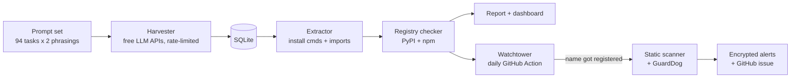

# SlopWatch

**An observatory for AI-hallucinated software packages.** SlopWatch measures how often AI coding assistants tell developers to install packages that don't exist, watches those fake names every day, and statically scans them the moment someone registers one.

[](../../actions/workflows/tests.yml)
**Live dashboard:** `https://<your-username>.github.io/slopwatch/`

---

## The problem: slopsquatting

LLMs sometimes recommend packages that sound right but don't exist:

```bash
npm install @opentelemetry/•••••••••    # looks official, doesn't exist (found by SlopWatch; masked until registered)
```

If an attacker registers that name and publishes malware, every developer who trusts the AI's answer installs it. Because models repeat the same hallucinations, the fake names are **predictable**, which is what makes the attack practical. Tools exist that check a single project's dependencies; SlopWatch instead **measures the problem across models over time** and **watches for the moment a fake name gets claimed**.

## Early findings (first run, Nov 2026, small sample)

| Model | Install recommendations | Pointed at non-existent packages |
|---|---|---|
| OpenRouter free router | 103 | 6.8% |
| gpt-oss-120b (Groq) | 259 | 3.1% |
| Gemini 3.5 Flash | 30 | 0% *(small sample)* |
| Qwen 3.8 27B (Groq) | 23 | 0% *(small sample)* |

- Hallucinations cluster in **AI / modern-stack** and **niche** tasks (up to 11% of install recommendations); common tasks showed **0%**.
- **npm** answers hallucinated about 4x more often than **PyPI** answers (6.9% vs 1.6%).
- Asking *"what is the best library to…?"* produced about 3.5x more fake packages than *"write a script that…"*.
- Fake names include convincing, official-looking scoped packages under well-known organisations' scopes.

Numbers update on the live dashboard as the dataset grows; these early figures are not yet statistically robust.

## How it works



| Stage | What it does |
|---|---|
| **Harvest** | Sends realistic coding questions (common, security and niche tasks, in Python and Node.js) to several models. One worker per model with its own rate limit; resumable; stops a model when its free quota runs out. |
| **Extract** | Parses package names from `pip / uv / poetry / npm / yarn / pnpm` commands and from imports. Only trusts commands inside code; ignores prose ("pip install the needed packages"), negations and placeholders. Maps import names to packages (`cv2` → `opencv-python`). |
| **Verify** | Looks every name up on PyPI and npm and classifies it: *established*, *new* (< 90 days), *empty* (name reserved, no code) or *missing* (hallucinated). |
| **Watch** | Re-checks every missing name daily and records a **flip** when one gets registered. |
| **Scan** | Downloads newly registered packages **into memory only** and scores them with transparent rules: install-time hooks (`setup.py`, npm `postinstall`, `.pth` autorun), `exec` of decoded data, exfiltration endpoints, credential paths, `curl \| sh`. Runs Datadog's GuardDog as a second opinion in CI. |

## Security design

This project handles attacker-useful data and untrusted code, so:

- **Untrusted code is never executed.** Packages are never installed or extracted to disk; archives are read in memory with download, per-file, total-size and member-count limits (zip-bomb and path-traversal safe).
- **The scanner is calibrated against false positives.** Each rule counts once per package, and weak signals (network calls, shell use) alone can't reach "high". Popular packages (`requests`, `boto3`, `numpy`, `lodash`, `axios`) score *low*.
- **No attacker shopping list.** Unregistered fake names are an attacker's to-do list, so the watchlist and alerts are committed **encrypted** (Fernet, AES-128 + HMAC-SHA256; key in a GitHub Actions secret). The public dashboard **masks** unregistered names; names are shown only once registered, as a warning. A test asserts that no unregistered name leaks into the published site.
- **Public issues contain counts only.** Details stay encrypted and are read locally with `slopwatch alerts`.
- **Responsible disclosure.** Malicious packages are reported to the registry before public discussion. SlopWatch never registers hallucinated names itself.
- Secrets live in `.env` (git-ignored); the CI token has only `contents` and `issues` write scopes.

## Quick start

Requires Python 3.11+ and [uv](https://docs.astral.sh/uv/). All model access uses free tiers.

```bash
uv sync
cp .env.example .env            # add free keys: Groq, Google AI Studio, OpenRouter
uv run slopwatch keygen          # creates SLOPWATCH_KEY for encrypted files

uv run slopwatch prompts         # build the prompt set
uv run slopwatch harvest         # ask the models (resumable)
uv run slopwatch check           # verify names on PyPI / npm
uv run slopwatch report          # hallucination rates + top fake names
uv run slopwatch watch           # re-check, detect registrations, scan
uv run slopwatch site            # build the dashboard into docs/
```

| Command | Purpose |
|---|---|
| `harvest --models groq:openai/gpt-oss-120b --runs 3` | Choose models; repeat prompts to measure repeatability |
| `scan npm <name>` | Statically scan any package (never installs it) |
| `alerts` | Decrypt and show the latest watchtower alerts |
| `models <provider>` | List models a provider currently offers |
| `crypt encrypt\|decrypt <src> <dst>` | Encrypt or decrypt a file with the project key |

## Tech stack

Python 3.11 · uv · SQLite (WAL) · httpx · OpenAI-compatible client for Groq / Gemini / OpenRouter / Ollama · `cryptography` (Fernet) · pytest · GitHub Actions (daily watch, tests) · GitHub Pages (dependency-free HTML/CSS/JS dashboard) · Datadog GuardDog. **Running cost: $0.**

## Project layout

```
src/slopwatch/
  providers.py   model endpoints, rate limits      harvest.py   resumable multi-model harvester
  prompts.py     prompt set from prompts/*.txt      extract.py   package-name extraction
  registry.py    PyPI/npm checks, flip detection   report.py    research metrics
  scanner.py     in-memory static scanner          watch.py     daily watchtower
  vault.py       encryption of sensitive data      site.py      dashboard builder
tests/           24 tests (extraction, registry mocks, scanner samples, encryption, no-leak check)
.github/workflows/  watch.yml (daily), tests.yml
```

## Limitations

- Rates are measured on install commands only; imports are reported separately because import names often differ from package names.
- "Missing" means missing at check time; a name may also belong to a package that was deleted earlier.
- Free-tier model lineups change; the model list is kept in `providers.py`.
- The scanner is a heuristic triage tool, not a malware verdict.

## Roadmap

- Repeatability study (`--runs 3`): which fake names models produce consistently
- More models and a larger prompt set (Stack Overflow questions)
- A pre-install guard that checks commands against SlopWatch's data
